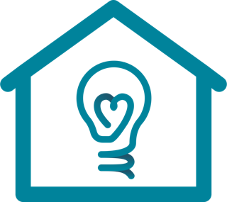

<p align="center">
  <a href="https://www.ceealar.org"></a>
</p>
<h1 align="center">noodles.</h1>
<p align="center"><em>Food for thought. Occasional nonsense.</em><br>CEEALAR's lightning-talk roulette: 200 topics · 70% knowledge · 30% chaos.</p>

```bash
noodles
```

Open a **GitHub Codespace**, let setup finish, then run the command. Port **8000** opens in your browser. Spin, take the floor, and make the room a little wiser. Or defend the moral superiority of a spoon.

**Space** to spin · no repeats by default · 1/3/5/10-minute fullscreen timer · broad, searchable topics · fullscreen spins & confetti reveals.

<details><summary>Running elsewhere / existing Codespace</summary>

Python 3.10+, no runtime dependencies.

```bash
python -m pip install -e .
noodles
```

Visit http://localhost:8000. Use `noodles --port 8001` for another port or `--no-browser` to skip opening a browser. If this Codespace predates the setup, run **Codespaces: Rebuild Container**, or use the install command above.

Edit [`topics.json`](ceealar_wheel/static/topics.json) to change the menu. Every eligible topic has equal odds; skipping played topics naturally changes the remaining 70/30 balance. Played history stays in this browser; **New evening** clears it.

</details>

<p align="center"><sub>Made for good people with strange questions.<br>CEEALAR logo from <a href="https://www.ceealar.org">ceealar.org</a>; belongs to its respective owner.</sub></p>
